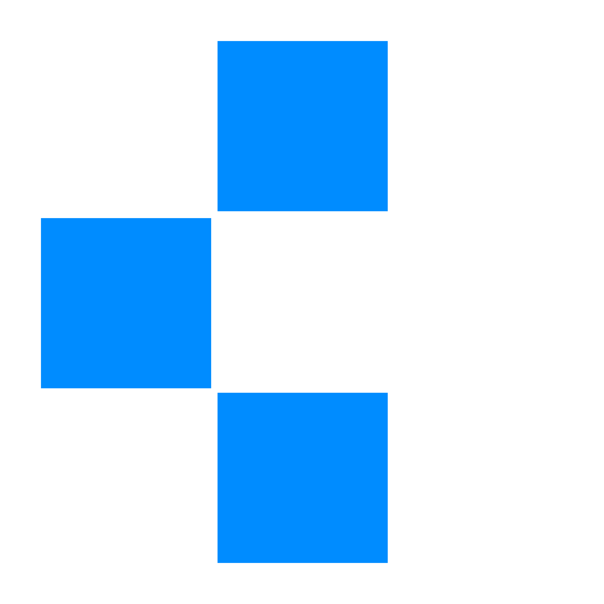

<p align="center">
  
</p>

<h1 align="center">Image Enhancement</h1>

<p align="center">
  
  
</p>

## CLAHE vs. CLAHE-NLM vs. NLM-CLAHE

> **Branch: `fitur/nlm-clahe`** — An interactive Streamlit lab for comparing three low-light image enhancement pipelines side by side — **CLAHE**, **CLAHE-NLM**, and the newly added **NLM-CLAHE** (reversed order) — backed by five objective image-quality metrics.

This project is the testbed application built for a research comparison on **low-light image enhancement**. Instead of just producing "prettier" images, it is designed to let you *measure* how much each method actually improves image quality, using quantitative metrics rather than eyeballing it.

This branch extends the main pipeline with a third scenario, **NLM-CLAHE**, which simply reverses the processing order (denoise first, then enhance contrast) to check whether order matters — a comparison requested during the Research Proposal (Usulan Penelitian) defense.

---

## What it does

Upload one or more low-light `.jpg` / `.jpeg` images and the app will, for every image:

1. Enhance it with **CLAHE** (Contrast Limited Adaptive Histogram Equalization).
2. Take that CLAHE result and denoise it with **Non-Local Means (NLM)**, producing the hybrid **CLAHE-NLM** result.
3. Run the reverse order instead — denoise first with **NLM**, then enhance contrast with **CLAHE** — producing the **NLM-CLAHE** result.
4. Score all three results against the original using **5 metrics**: `MSE`, `RMSE`, `PSNR`, `SSIM`, and `FSIM`.
5. Lay everything out in a gallery with interactive RGB histograms, plus an accumulating experiment log you can export straight to Excel.

It's built to answer two questions clearly: *does adding denoising on top of CLAHE actually help — and does the order in which the two steps run change the outcome?*

---

## How the pipeline works

### 1. CLAHE — contrast enhancement

```
RGB -> CIELAB -> CLAHE on the L (lightness) channel only -> back to RGB
```

Working in **CIELAB** color space means contrast is enhanced on the lightness channel alone, while the `a`/`b` color channels are left untouched — this avoids the color distortion you'd get by equalizing each RGB channel independently. The L/a/b channels are sliced using plain NumPy array indexing (not OpenCV's `split()`), and the tile grid is locked at a constant **8x8**, while the **Clip Limit** (2.0–4.0) is adjustable live from the sidebar.

### 2. NLM — denoising the CLAHE output

CLAHE boosts contrast, but it can also amplify noise that was hiding in the dark regions of the image. The hybrid pipeline feeds the CLAHE output into **Non-Local Means Denoising** (`cv2.fastNlMeansDenoisingColored`) to clean that noise up — giving the **CLAHE-NLM** result. The filter strength `h` (1–20) is also adjustable live.

### 3. NLM-CLAHE — the reversed pipeline (new on this branch)

```
RGB -> NLM (denoise original) -> CLAHE (enhance contrast on the denoised result)
```

This scenario simply flips the order of step 1 and step 2: noise is removed from the **original** image first, and CLAHE's contrast enhancement is applied afterwards, on the already-denoised result. It's implemented as `apply_nlm_clahe()` in `src/processing.py`, which internally just calls `apply_nlm()` then `apply_clahe()` with the same parameters (Clip Limit, grid size, `h`) used by the other two pipelines — so the three scenarios stay directly comparable.

The point of this scenario is to check whether **processing order** changes the outcome, since CLAHE and NLM can interact differently depending on which one sees the noisy pixels first.

### 4. Evaluation — 5 metrics, two "arenas"

| Metric | Measures | Computed on |
|---|---|---|
| **MSE** | Raw pixel-wise error | Full RGB |
| **RMSE** | Square root of MSE (same units as pixel values) | Full RGB |
| **PSNR** | Signal-to-noise ratio (higher = closer to original) | Full RGB |
| **SSIM** | Perceived structural similarity | Grayscale |
| **FSIM** | Feature similarity via phase congruency + gradient magnitude | Grayscale |

The **FSIM** implementation is the most hand-built part of the app: phase congruency is computed from scratch with NumPy + FFT (log-Gabor filters across 4 scales x 4 orientations) — no `phasepack` dependency and no automatic image resizing, so the score reflects the image at its true resolution. A small LRU-style cache avoids recomputing the expensive phase-congruency transform when the same original image is scored twice in a row (once against CLAHE, once against CLAHE-NLM).

---

## App features

- **Multi-file upload** — drag in several `.jpg`/`.jpeg` images at once
- **Live parameter tuning** — Clip Limit (CLAHE) and filter strength `h` (NLM), both adjustable from the sidebar
- **Side-by-side gallery** — Original vs. CLAHE vs. CLAHE-NLM vs. NLM-CLAHE, per image, searchable by filename
- **Interactive RGB histograms** — per channel, per image, rendered with Altair
- **Metric scorecards** — all 5 metrics shown for all three methods on every image
- **Accumulating experiment log** — every run is appended to a running table (duplicate filenames are automatically skipped)
- **One-click Excel export** — download the full log as a `.xlsx` report
- **Custom dark theme** — IBM Plex Sans/Mono + Space Grotesk, styled via `.streamlit/config.toml`

---

## Project structure

```
image-enhancement-new/
├── app.py                  # Streamlit UI, orchestration, logging, export
├── src/
│   ├── processing.py       # apply_clahe(), apply_nlm(), apply_nlm_clahe()
│   └── metrics.py          # calculate_metrics() — MSE, RMSE, PSNR, SSIM, FSIM
├── pilot_test_nlm_clahe.py # Standalone script: compares CLAHE, CLAHE-NLM, NLM-CLAHE on one image
├── pilot_test_hasil.csv    # Output of the pilot test script
├── dataset/                 # Sample low-light images (ExDark-sourced) for testing
├── output/                  # Generated experiment reports (.xlsx)
├── .streamlit/
│   └── config.toml          # Custom dark theme configuration
├── logo.png
└── requirements.txt
```

---

## Getting started

### Prerequisites

- Python 3.9+
- pip

### Installation

```bash
# Clone the repository
git clone https://github.com/abdeealfarizi/image-enhancement-new.git
cd image-enhancement-new

# (Recommended) create a virtual environment
python -m venv venv
source venv/bin/activate      # On Windows: venv\Scripts\activate

# Install dependencies
pip install -r requirements.txt
```

### Run it

```bash
streamlit run app.py
```

The app will open in your browser at `http://localhost:8501`.

### Using the app

1. Open the sidebar and upload one or more `.jpg`/`.jpeg` images (try the samples in `dataset/`).
2. Adjust **Clip Limit** and **Filter NLM (h)** to taste.
3. Click **Proses** to run both pipelines on every uploaded image.
4. Expand each image card to compare results, check metric scores, and toggle histograms.
5. Click **Unduh Excel** to download the full experiment log.
6. Click **Atur Ulang** to clear everything and start a new batch.

---

## Pilot test script

Besides the main app, this branch adds `pilot_test_nlm_clahe.py`, a small standalone script for quickly sanity-checking the three scenarios on a single image without going through the UI.

```bash
python pilot_test_nlm_clahe.py
```

Edit `NAMA_FILE_CITRA` at the top of the script to point at any image in `dataset/`, then run it. It prints a metrics table for all three scenarios (CLAHE, CLAHE-NLM, NLM-CLAHE) side by side, plus the difference between NLM-CLAHE and CLAHE-NLM so you can see immediately whether the order change moved the numbers — and saves the result to `pilot_test_hasil.csv`.

Sample output from this branch (tested on `dataset/2015_00024.JPG`, Clip Limit 2.0, `h` = 10):

| Metric | CLAHE | CLAHE-NLM | NLM-CLAHE |
|---|---|---|---|
| MSE | 749.3328 | 717.0345 | 530.5463 |
| RMSE | 27.3739 | 26.7775 | 23.0336 |
| PSNR | 19.3841 | 19.5754 | 20.8836 |
| SSIM | 0.7755 | 0.7931 | 0.7798 |
| FSIM | 0.8888 | 0.9127 | 0.9007 |

On this sample, NLM-CLAHE actually scores better on MSE/RMSE/PSNR but slightly lower on SSIM/FSIM than CLAHE-NLM — a good illustration of why this branch evaluates on 5 metrics rather than just one.

---

## Tech stack

| Layer | Tools |
|---|---|
| UI / App framework | [Streamlit](https://streamlit.io/) |
| Image processing | [OpenCV](https://opencv.org/) (`opencv-python-headless`), [NumPy](https://numpy.org/) |
| Metrics | [scikit-image](https://scikit-image.org/) (SSIM, PSNR, MSE), custom FSIM (NumPy + FFT) |
| Data & export | [Pandas](https://pandas.pydata.org/), [OpenPyXL](https://openpyxl.readthedocs.io/) |
| Charts | [Altair](https://altair-viz.github.io/) |

---

## Context

This repository supports an undergraduate thesis comparing **CLAHE** against **CLAHE-NLM** for enhancing everyday low-light photographs (as opposed to prior work that tested the same hybrid approach only on medical imagery). The Streamlit app functions as the experimental testbed: a controlled, reproducible environment for running the methods on identical inputs and parameters, then comparing the resulting metrics side by side.

The **`fitur/nlm-clahe`** branch adds the **NLM-CLAHE** (reversed-order) scenario as a direct response to feedback from the Research Proposal defense panel, so the thesis can report whether processing order is a meaningful factor or not.

---

## License

No license has been specified yet. All rights reserved by the author unless stated otherwise.